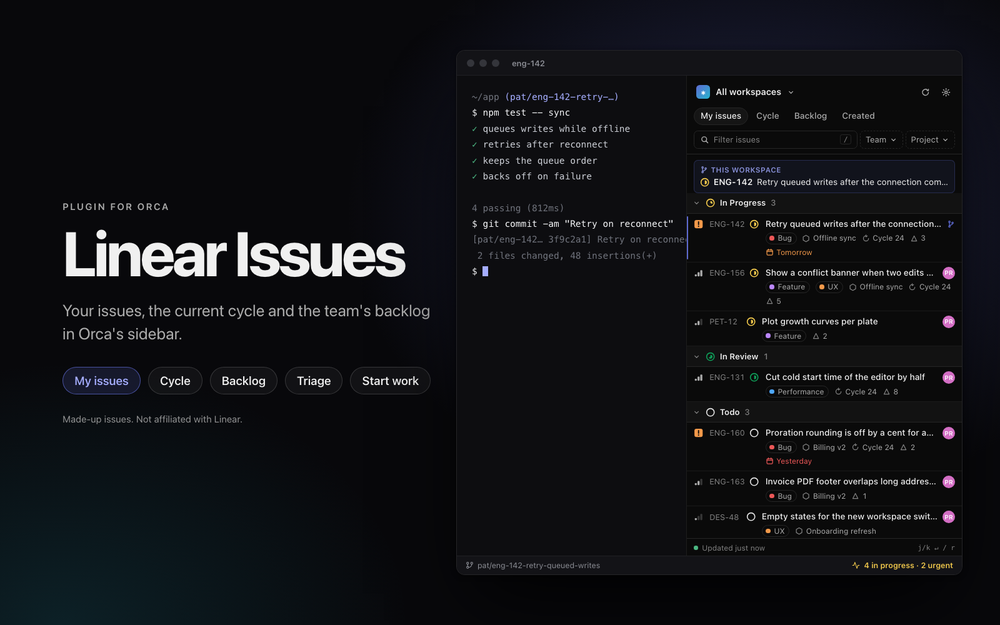
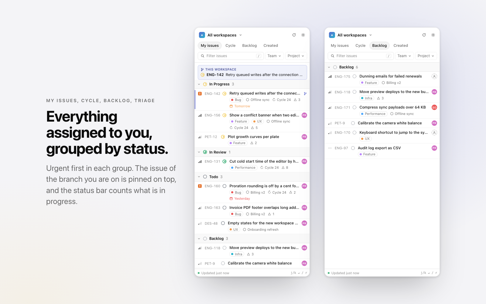
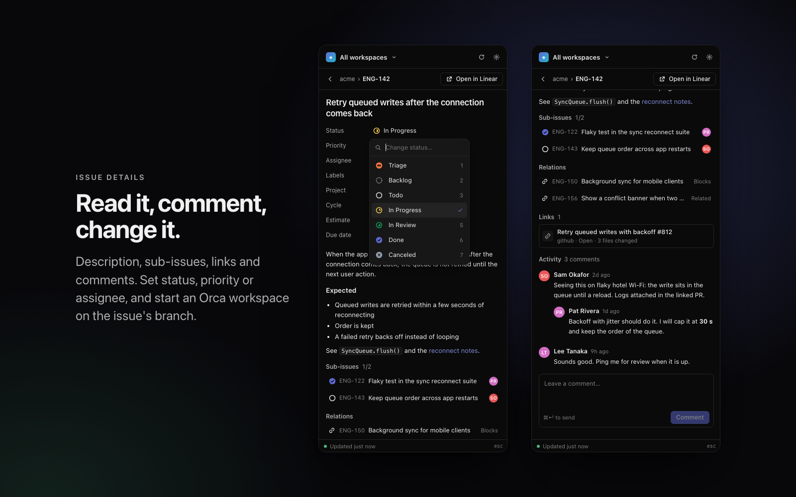
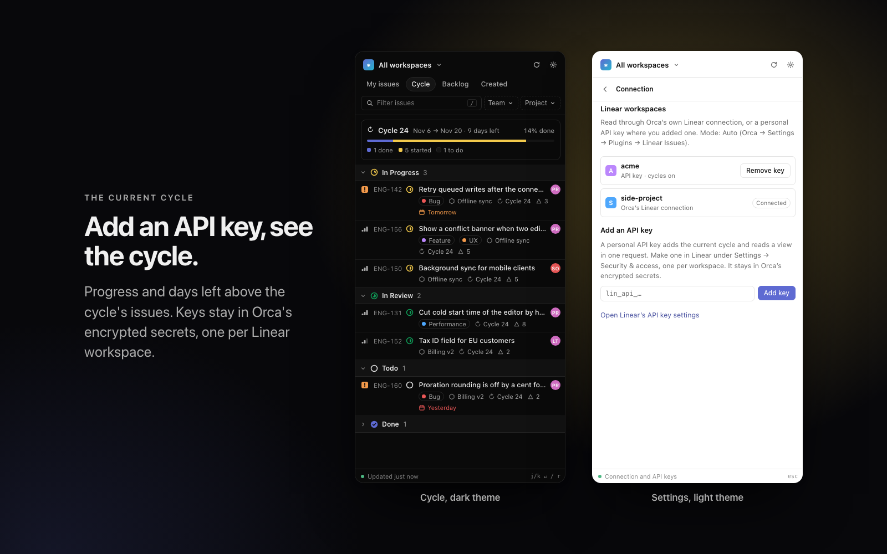

# Linear Issues for Orca

Your Linear issues in [Orca](https://github.com/stablyai/orca)'s sidebar: not only the issue of
the branch you are on, but everything assigned to you, the current cycle, your team's backlog,
what you created and triage. Open an issue to read it, change its status, priority or assignee,
comment, or start a workspace for it. A status bar item counts what is in progress and urgent.

Not affiliated with Linear. It uses Orca's own Linear connection, so there is nothing to set up.

**[Open in Orca →](https://onorca.dev/plugins/bautistapessagno.linear-issues)** &nbsp;·&nbsp;
share link: `orca://plugins/bautistapessagno.linear-issues?catalog=community`



## What you get

- **My issues**, grouped the way Linear groups them: In Progress, In Review, Todo, Backlog, then
  recently completed and canceled work, collapsed. Urgent first inside each group.
- **Cycle**, **Backlog**, **Created** and **Triage** (when the team has a triage state).
- Each row shows the priority, identifier, status, title and assignee, then labels, project,
  cycle, estimate and due date (overdue in red).
- Filters by Linear workspace, team and project, and a filter box. Press Enter in it to search
  all of Linear.
- The issue of the Orca workspace you have open (read from its branch name, such as
  `pat/eng-142-fix-sync`) is pinned at the top and marked in the list.
- **Issue details** in the panel: description, sub-issues, relations, links and comments.
  **Open in Linear** opens it in your browser.
- **Changes**: status, priority, assignee and new comments, sent to Linear when you pick them.
- **Start work**: opens the Orca workspace already on the issue's branch, or makes a new one from
  the repository of the workspace you have open, linked to the issue.
- **Status bar**: `3 in progress · 1 urgent`, amber while something urgent is open, hidden when
  there is nothing to count.
- Optional desktop notification when an issue is newly assigned to you.







All issues, teams and people in these images are made up.

## Install

Needs Orca 1.4.248 or newer, with Linear connected in Orca's settings.

1. Open [the plugin's page](https://onorca.dev/plugins/bautistapessagno.linear-issues) and click
   **Open in Orca**, or in Orca: Settings → Plugins → search **Linear Issues** in the community
   catalog. By hand: **Install plugin** → Git URL →
   `https://github.com/BautistaPessagno/orca-linear#v0.1.0`.
2. Full-access plugins need Orca's setting that allows them (off by default).
3. Review what it asks for and click **Enable**:
   - its own storage, settings and encrypted secrets (the issue cache, your settings, API keys);
   - read your focused workspace's name and branch (to find its issue);
   - open your workspaces (for **Start work**);
   - show desktop notifications (only if you turn them on).
4. Open **Linear Issues** in the right sidebar.

## The current cycle: add a Linear API key

Orca's Linear connection tells the plugin everything except which cycle is current. To see the
**Cycle** view, add a personal API key for that Linear workspace:

1. In Linear: Settings → Security & access → **Personal API keys** → New key. Changes you make
   from the panel go through the key too, so give it write access if Linear asks.
2. In the panel: the gear icon → paste the key → **Add key**. The plugin checks it with Linear and
   keeps it in Orca's encrypted secrets.

A key belongs to one Linear workspace; add one per workspace. With a key, that workspace is read
through Linear's API directly (one request per view); the rest keep using Orca's connection.
Remove a key from the same screen.

## Keyboard

| Key | In the list | In an issue |
| --- | --- | --- |
| `j` `k` or arrows | move | |
| `Enter` | open the issue | |
| `/` | filter | |
| `1`–`5` | switch view | |
| `r` | refresh | |
| `o` | open in Linear | open in Linear |
| `s` `p` `a` | | status, priority, assignee |
| `c` | | write a comment (`⌘↵` sends) |
| `Esc` | clear the filter | back to the list |

## Settings

Orca → Settings → Plugins → Linear Issues:

- **Connection**: Auto (Orca's connection, plus API keys where you added one), Orca's connection
  only, or API keys only.
- **Refresh every**: how often your issues and the status bar refresh (default 5 minutes).
- **Show completed work from the last**: days of completed and canceled issues kept in the list.
- **Notify me of new assignments**: off by default.
- **Orca CLI path**: only if the plugin cannot find Orca's command line tool by itself.

## Privacy

Issue data goes only between Orca, this plugin and Linear. The plugin keeps a cache of your lists
in its own storage so the panel opens instantly; API keys stay in Orca's encrypted secrets. Issue
text is shown as text: links open only when you click them, and nothing in an issue can run code
in the panel.

## Development

Plain `.mjs`, no build step and no dependencies.

```sh
node --test                      # or: orca plugin test .
orca plugin validate .
orca plugin check .
orca plugin dev watch . --check --shot .orca/shots
```

Writes are tested against fakes only. With a file `.scratch/fixtures.json` in the folder
(git-ignored), the worker serves made-up issues instead of yours, for screenshots; see
`scripts/fixture-backend.mjs`. The images in `images/` (cover, screenshots, icon) are rendered
from the real panel and worker on that data with `node scripts/render-listing-images.mjs` (needs
Google Chrome). Research and design: `docs/research/linear-backends.md` and
`docs/specs/linear-issues/spec.md`.

## License

MIT
