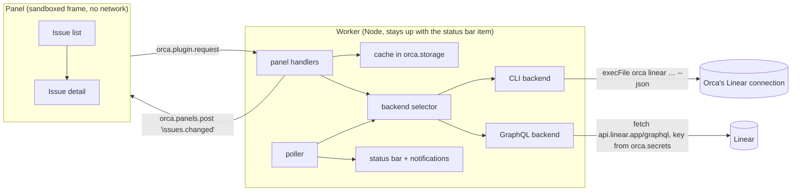
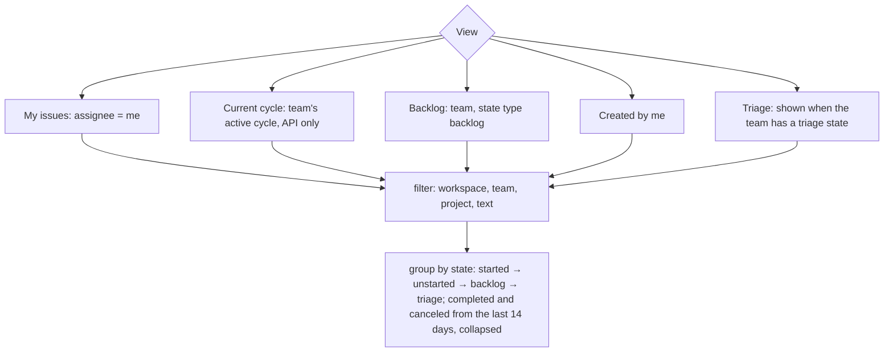
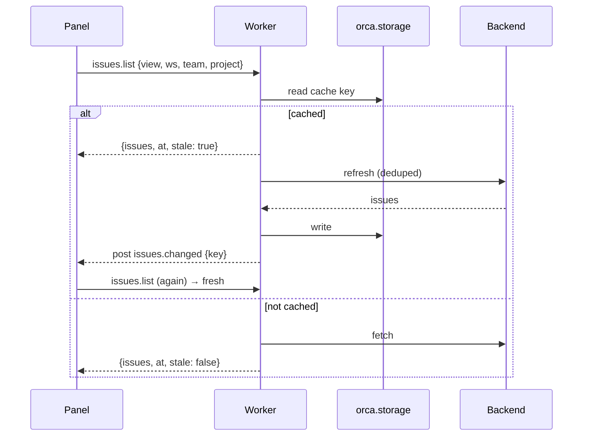

# Linear Issues for Orca

Artifact: https://claude.ai/artifact/TzyVKNZpic3o1dXxrCaf4L

## Problem

Orca shows the one Linear issue linked to the focused workspace. Everything else (what is
assigned to me, what is in review, the team's backlog, the current cycle) means leaving Orca for
Linear. The user wants their whole Linear picture beside their code, across both Linear
workspaces they connected to Orca (a company one and a personal one).

## Solution

A `trusted-worker` plugin in Now Playing's architecture: an HTML panel in the right sidebar, a
worker that owns every Linear call, and a status bar item.



### Backends behind one interface

```
Backend {
  id: 'cli' | 'api'
  workspaces()                         → [{ id, name }]
  teams(ws)                            → [{ id, key, name, color, workspaceId }]
  listIssues(ws | 'all', query)        → { issues: Issue[], partial, errors }
     query = { view: mine|created|backlog|cycle|triage|search, team?, project?, text? }
  issue(ws, key)                       → IssueDetail (description, children, relations,
                                         comments, attachments)
  teamMeta(ws, teamKey)                → { states, members, labels }
  update(ws, key, change)              → void; change = { state } | { priority } | { assignee }
  comment(ws, key, body)               → void
  capabilities                         → { cycles, triage }
}
```

- **CLI backend** (zero setup, default): runs `orca linear … --json` with Orca's own connection.
  It cannot tell the current cycle (see `docs/research/linear-backends.md`).
- **GraphQL backend** (optional): a personal API key per Linear workspace, pasted in the panel,
  kept in `orca.secrets` under `apiKey:<workspaceId>`. Adds the current cycle and is one request
  per view.
- **Selector**, setting `backend` = `auto` (default) | `cli` | `api`. `auto` serves a workspace
  with the API when it has a key, and with the CLI otherwise. Workspaces from both are merged by
  id.

Finding `orca`: the `orcaPath` setting, then derived from `process.execPath` (the worker runs
inside Orca.app), then `PATH`, then well-known paths; each checked with `--version`.

### Views



Within a group: priority (urgent first, none last), then most recently updated. Groups are the
team's own states ("In Progress", "In Review", "Todo", "Backlog"), ordered by type and the
state's position.

Each row: priority glyph, identifier, status glyph, title, assignee avatar; a second line with
labels, project, cycle, estimate and due date (overdue in red). The focused workspace's issue
(issue key parsed from `workspace.readContext().branch`) gets a branch mark and a pinned strip at
the top.

Detail: status, priority and assignee pickers, labels, project, cycle, estimate, due date,
description (markdown rendered as text nodes, never HTML), sub-issues, relations, links,
comments, and a comment box. "Open in Linear" calls `shell.openExternal` on a press.

Start work: when an Orca workspace's branch contains the issue key (or equals the issue's
`branchName`), "Open workspace" calls `workspace.open`. Otherwise "New workspace" runs
`orca worktree create --name <key> --branch <branchName> --linear-issue <key> --activate
--no-parent` from the focused workspace's folder, so Orca picks that repository. Hidden when no
workspace is focused.

### Cache and refresh



The poller refreshes "My issues" across all workspaces every `refreshMinutes` (default 5) and
from it:

- **Status bar**: `N in progress · M urgent` (open, priority 1), tone `warning` when M > 0,
  hidden when both are 0.
- **Notifications** (setting `notifyAssigned`, default off): an open issue assigned to me that
  was not in the last poll. The first poll after start only records.

### Writes

Status, priority, assignee and comments, only from a press in the panel. The worker validates
each input (known state name of the issue's team, priority 0–4, member id from the team or `me`
or none, comment 1–10 000 chars), runs the backend write, refetches the issue and invalidates
cached lists. Tests run every write path against fakes; nothing writes to a real workspace while
building.

### Safety

- Everything from Linear is untrusted data: rendered with `textContent`, links opened only on a
  press and only `http(s)`.
- Avatars: the worker fetches only URLs it handed out itself, `https` and `image/*`, at most
  48 KiB, cached; they reach the panel as `data:` URLs.
- CLI arguments go through `execFile` (no shell); comment bodies go on stdin
  (`--body-file -`).

### Capabilities

`storage:own`, `secrets:own`, `settings:own` (cache, keys, settings), `workspace:read` (focused
issue, matching workspaces), `workspace:write` (open a workspace), `notifications:show`.

### Settings

`backend` (auto/cli/api), `orcaPath`, `refreshMinutes` (1–60, default 5), `completedDays`
(default 14), `notifyAssigned` (default off).

## Testing

`node --test` with injected fakes: CLI runner fake (asserts argv, answers fixture JSON),
GraphQL fetch fake, Orca host fake. Made-up fixture data only. `orca plugin validate`, `test`
and `check` pass; screenshots of list, detail, empty, error and setup states in light and dark.

## Out of scope

Creating issues, editing labels, estimates or due dates, webhooks, offline writes.

## Decided while building

- **Cycle view** shows a summary card (cycle number, dates, days left, done / started / to do by
  issue count) above the groups. Without an API key it shows why and offers to add one.
- **Lasting refresh failures** (no key, no connection, no CLI) drop the cached list, so the panel
  shows the reason instead of an old list.
- **Lost requests**: a panel read sent while the worker restarts times out after 25 s and is sent
  once more. Writes are never resent.
- **Light theme**: Linear's light-grey state colours (Todo, Backlog) are swapped for a mid grey on
  light themes, and very dark ones on dark themes.
- **Screenshots** use made-up data: with the git-ignored `.scratch/fixtures.json`, the worker
  serves `scripts/fixture-backend.mjs` and keeps its cache under a separate storage prefix.
  Orca's `plugin shot --theme light` only works with Orca's window hidden, so light theme was
  checked by rendering the same panel files in headless Chrome with a stub `orca` and light
  `--orca-*` tokens.
- **Workspace ids**: the CLI's workspace id is assumed to equal Linear's organization id, which is
  what an API key reports; that merge is untested against a real key.
